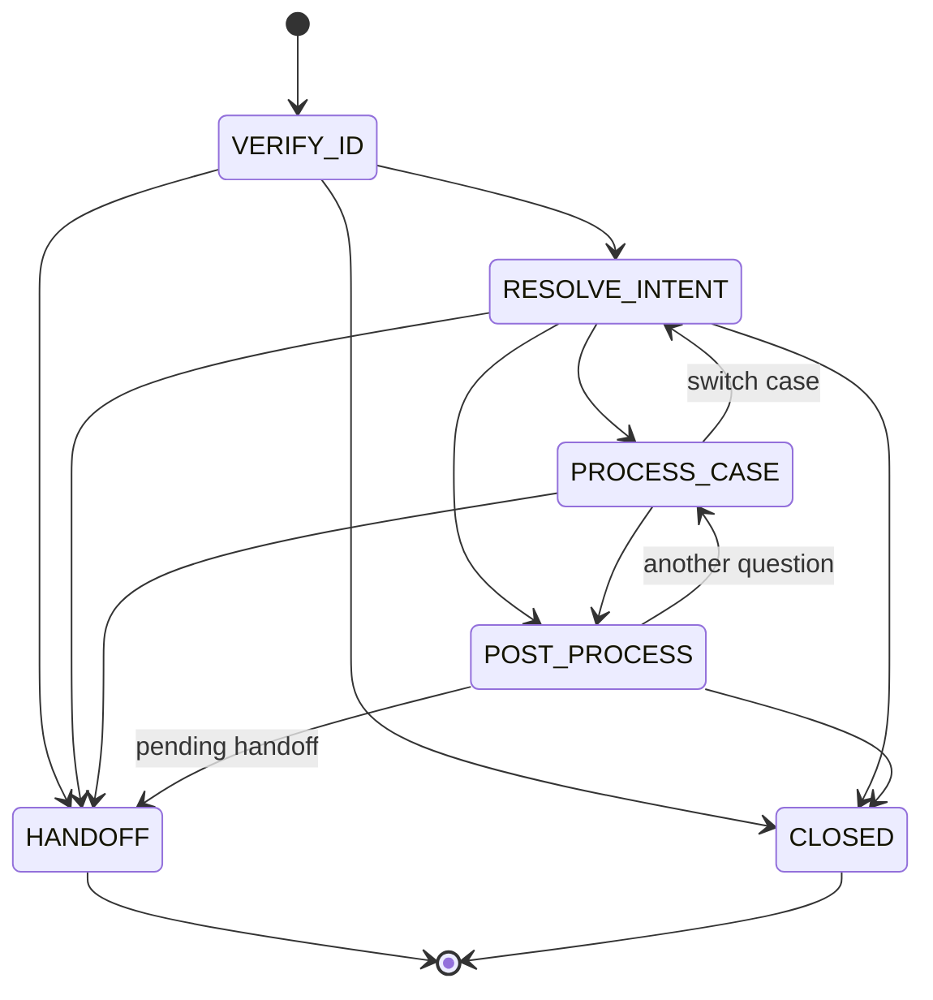

# Architecture

The React chat calls FastAPI. A session-local lock serializes message and consent polling requests. The backend loads the six read-only fixtures and runs the same SOP engine regardless of model provider. The deployed image serves the compiled chat and API on the same port.

## Turn processing

1. `Engine.handle_turn` in [engine.py](../backend/app/sop/engine.py) constructs extraction context from the phase, pending question, and last agent message. Structured extraction is reconciled with regex matches for formatted fields. Explicit quick replies use typed actions. Consent events use a deterministic path.
2. The [memory merger](../backend/app/sop/memory.py) stores normalized slots and provenance. The engine can use a hint captured before verification once access is granted.
3. `decide` applies global guards and the phase policy. Each policy returns directives and a proposed transition. The engine validates transitions against [phases.py](../backend/app/sop/phases.py).
4. `build_context` in [context.py](../backend/app/sop/context.py) builds the permitted facts and tool list for the resulting phase.
5. The responder phrases the directives. During claim processing, supported providers can call a bounded registry of read-only tools. Providers without tool calling receive deterministic guidance in the fact pack.
6. `check_reply` screens the draft for leakage, PII echoes, and selected unsupported factual tokens. A failed check can trigger one regeneration, followed by a deterministic template. The engine returns messages, quick replies, and a redacted snapshot. The Inspector surfaces decisions, provenance, and the mock Outbox.

## Invariants

| Invariant | Enforcement | Evidence |
| --- | --- | --- |
| I1. Phase changes belong to the policy engine. | `decide` and `_apply` process `StepResult` transitions through the allowlist. The responder receives facts, directives, and read-only operations. | `tests/unit/test_decide_context.py::test_only_decide_calls_transition`, `tests/unit/test_phases_state.py::test_illegal_transition_raises`, `tests/unit/test_llm_impls.py::test_responder_no_tools_when_not_allowed` |
| I2. Claim disclosure requires access. | The verification policy grants access for a matched policyholder or a registered representative with approved consent. Context before access contains safe facts and caller-provided hints. | `tests/scenarios/test_scenarios.py::test_s2_no_record_data_in_prompts_before_resolve`, `tests/scenarios/test_scenarios.py::test_s7b_question_while_consent_pending_leaks_nothing` |
| I3. The tool registry enforces permissions. | Claim tools require access, a processing phase, and ownership of the requested claim. | `tests/unit/test_registry.py::test_registry_denies_before_access`, `tests/unit/test_registry.py::test_registry_denies_outside_process_phase`, `tests/unit/test_registry.py::test_registry_denies_other_party_case` |
| I4. Reply facts come from allowed context, tool results, and the caller's own statements. | The prompt sets the rule. The output guard checks supported token classes and retries or falls back after a violation. This is bounded enforcement for detectable tokens. | `tests/unit/test_output_guard.py::test_ungrounded_amount_flagged`, `tests/unit/test_output_guard.py::test_ungrounded_case_id`, `tests/scenarios/test_engine_core.py::test_both_attempts_violate_falls_back_to_template` |

## Phase transitions

A single turn can follow up to `max_hops` (3) validated transitions, so it runs at most `max_hops + 1` phase handlers; a global guard's continued transition counts against that budget. The last handler's own transition is still applied but not followed, so the phase can change at most `max_hops + 1` times in one turn. Each handler sees the same extraction, and the engine accumulates directives as it goes. The final plan determines which facts to load. Margaret's opening turn can verify identity, resolve the remembered January denied healthcare claim, and answer from CL-2048 in one response. Earlier turns and pending representative consent retain restricted context. System consent polls acknowledge changes without replaying the prior utterance through the workflow.

## Design choice

Approach A puts the state machine, authorization, and deterministic transition tests in ordinary Python. The model interprets ambiguous wording and writes the response, with read-only function calling during claim handling. Two model calls on a typical text turn and additional orchestration code are the cost of explicit gates and a naturally phrased response.
